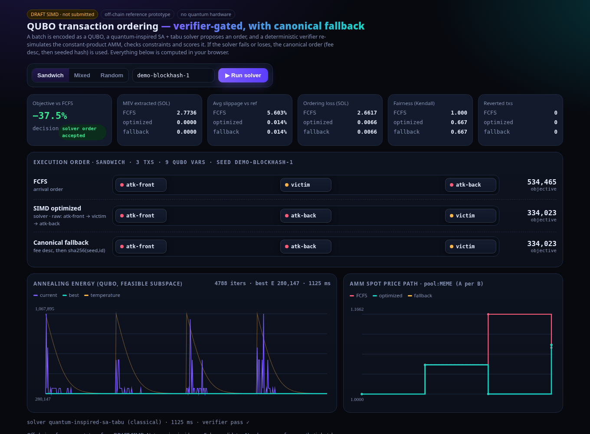

# simd-qubo-ordering

Reference prototype for a **DRAFT** SIMD: *verifier-gated intra-batch
transaction ordering via QUBO solvers, with a canonical fallback.*

> Off-chain prototype. It does not run inside any Solana validator. The
> default solver is classical "quantum-inspired" simulated annealing + tabu,
> and no quantum hardware is used. All numbers come from synthetic batches.

A contention batch is encoded as a QUBO. A solver proposes an order. A
deterministic integer-only verifier re-simulates a constant-product AMM,
checks constraints and scores the order. If the solver fails or loses, the
canonical order (fee desc, then seeded hash) is used.

- Proposal: [`proposals/XXXX-qubo-transaction-ordering.md`](proposals/XXXX-qubo-transaction-ordering.md)
- Agave / SVM integration notes: [`docs/integration.md`](docs/integration.md)
- Forum post draft: [`forum/discussion-post.md`](forum/discussion-post.md)
- Demo (single static file, no build): [`demo/index.html`](demo/index.html)



## Quick start

Requires Node ≥ 23.6, which runs `.ts` files directly. There are no runtime
dependencies; TypeScript is used only for `npm run typecheck`.

```sh
npm install          # dev toolchain only (typescript, @types/node, esbuild)
npm test             # node:test, 32 tests
npm run typecheck
node src/cli.ts fixtures/sandwich.json                                    # spec mode (default)
node src/cli.ts fixtures/mixed.json --tiebreak sha1-compat --baseline fcfs --json   # legacy parity mode
npm run gen:conformance   # regenerate fixtures/conformance/*.json (spec vectors)
npm run build:browser     # bundle the real client for the browser -> browser/dist/simd-client.js
open demo/index.html # or any static server; add ?static to disable animations
```

## The reference client: spec mode vs legacy parity mode

`src/` is the full reference client for the proposal: QUBO encode →
`quantum-inspired-sa-tabu` solver → exact-objective polish → deterministic
verifier → accept iff `pass && score ≤ canonical`, else the canonical order.
Batches are capped at the proposal's `MAX_BATCH` guidance by the caller; the
pipeline itself is batch-size agnostic.

The verifier has two modes, because the captured live fixtures predate the
amended proposal:

| | **Spec mode (default)** | **Legacy parity mode** |
|---|---|---|
| Canonical tie-break | `SHA-256("simd-qubo-ordering/canonical/v1:" \|\| seed \|\| ":" \|\| tx_id)` | `sha1-compat` (`sha1("simd420:"+seed+":"+id)`, inferred) |
| `noNewReverts` baseline | **the canonical order** | the arrival (FCFS) order |
| Selected by | `verify(b, order)` / `run(b)` defaults; `SPEC_VERIFY` | `LEGACY_VERIFY`; `run(b, { baseline: 'fcfs', tieBreak: 'sha1-compat' })`; CLI `--baseline fcfs --tiebreak sha1-compat` |
| Checked against | `fixtures/conformance/*.json` | `fixtures/*.json` (captured live responses) |

Spec mode is the behaviour the proposal standardises: basing the revert
baseline on the canonical order makes `pass` recomputable by any observer
from the block alone (arrival order is a leader-local observation). Legacy
mode exists only to keep reproducing the captured live vectors; the mode
changes pass/fail only — execution, metrics, scores and state hashes are
identical in both modes for the same order.

### Conformance vectors (spec)

`fixtures/conformance/{sandwich,mixed}.json` are generated entirely under the
spec definitions (SHA-256 tie-break, canonical revert baseline, the state-hash
layout below) by `npm run gen:conformance`. `test/conformance.test.ts`
re-runs the full pipeline and asserts byte-for-byte reproduction of the
orders, metrics, scores, accept/fallback verdict and state hashes. Under the
spec definitions: sandwich — FCFS 534,465 · canonical 334,023 · solver
334,023 (accepted); mixed — FCFS 361,250 · canonical 481,359 · solver 164,938
(accepted). (The mixed canonical score differs from the captured live vector's
453,581 precisely because the spec tie-break produces a different canonical
order; that is the scope split the proposal's Conformance section describes.)

### State hash

SHA-256 (spec step 6) over the UTF-8 concatenation:
`"simd-qubo-ordering/v1|" seed "|" order.join(",") "|"`, then per pool sorted
by id `poolId ":" reserveA ":" reserveB ";"`, then per transaction in the
executed order `txId "=" outcome ";"` where outcome is the executed output
amount in decimal, `R` if reverted, or `-` for a non-swap transaction. The
exact code is the tail of `verify()` in `src/verifier.ts`.

### Browser bundle

`npm run build:browser` bundles the real `src/` modules (entry:
`browser/entry.ts`, scenarios sandwich/mixed/devnet) with esbuild.
`node:crypto` is aliased to a small pure-TypeScript SHA-256/SHA-1
(`browser/crypto-shim.ts`, pinned to `node:crypto` by
`test/crypto-shim.test.ts`) because WebCrypto is async-only and the verifier
is synchronous; `node:fs` is stubbed (the entry imports fixture JSON directly
and calls `parseBatch`). There is no second, hand-ported engine: the bundle
is the client. This bundle is what the https://musebook.trade/simd page runs
in-browser.

Sandwich output:

```
                                            FCFS       optimized       canonical
MEV extracted (SOL)                       2.7736          0.0000          0.0000
Avg slippage vs reference (%)             5.6029          0.0138          0.0138
Ordering loss to traders (SOL)            2.6617          0.0066          0.0066
Fairness (Kendall vs arrival)              1.000           0.667           0.667
Objective score (lower=better)           534,465         334,023         334,023
FCFS:      atk-front → victim → atk-back
Optimized: atk-front → atk-back → victim  (solver order accepted)
```

## Layout

| Path | What |
|------|------|
| `src/amm.ts` | constant-product quote (`fee = ⌊in·bps/1e4⌋`, fee stays in pool) |
| `src/verifier.ts` | simulation, constraints, metrics, integer objective, state hash |
| `src/canonical.ts` | canonical fallback order + FCFS |
| `src/qubo.ts` | permutation QUBO encode, energy, decode/repair |
| `src/solver.ts` | `quantum-inspired-sa-tabu` (deterministic, seeded) |
| `src/pipeline.ts` | encode → solve → optional external hook → polish → verify → accept/fallback |
| `src/serialize.ts` | stable JSON serialization of results (conformance vectors, browser API) |
| `src/cli.ts` | CLI (`--tiebreak`, `--baseline` select spec/legacy mode) |
| `fixtures/*.json` | verbatim responses from the live devnet API (legacy test vectors) |
| `fixtures/conformance/*.json` | spec-mode conformance vectors, generated by `scripts/generate-conformance.ts` |
| `test/` | spec conformance + spec/legacy baseline divergence + legacy live parity + sandwich example + QUBO/fallback properties + crypto-shim parity |
| `browser/` | browser entry + `node:crypto`/`node:fs` shims for the esbuild bundle of the real client |
| `demo/index.html` | self-contained in-browser demo (engine ported inline; superseded on musebook.trade/simd by the bundled client) |

## Live API (source of the fixtures)

The page https://devnet.x402.wtf/simd420 is a client-rendered SPA. Its lazy chunk
`assets/Simd420-*.js` fetches the following from `https://clawd-pump-api-devnet.onrender.com`:

- `GET /api/simd420/demo?scenario=sandwich`
- `GET /api/simd420/demo?scenario=mixed`
- `GET /api/simd420/devnet` (real devnet trade sizes/directions; reserves modeled)

Response shape: `{ok, scenario, source, slot, seed, txCount, pools[], txs[], spec, fcfs, optimized, canonical, disclaimer}`.
`api.x402.wtf` returns 404 for these paths.

## Parity with the live prototype

The prototype's server source was not recoverable, so this repo is a clean-room
reimplementation fitted to its outputs. For all three captured fixtures, the
verifier **in legacy parity mode** reproduces the live FCFS, optimized and
canonical metrics and scores exactly (MEV lamports, slippage, loss, fairness,
CU, score). The solver's scores are equal to or better than the live ones. On
`mixed`, the order differs from the live one but the score is the same
(164,938).

The live canonical tie-break hash is not SHA-256. `sha1("simd420:"+seed+":"+id)`
reproduces every captured canonical order, but several other hashes do too,
so the exact function is unknown. That variant is available as
`--tiebreak sha1-compat`. The proposal and the client default use SHA-256 with
a domain tag, and the spec state hash defined above; neither matches the live
prototype's (its state-hash definition was not recoverable). Spec behaviour is
pinned by `fixtures/conformance/`, live behaviour by legacy mode — see "The
reference client" above.

## License

Apache-2.0
